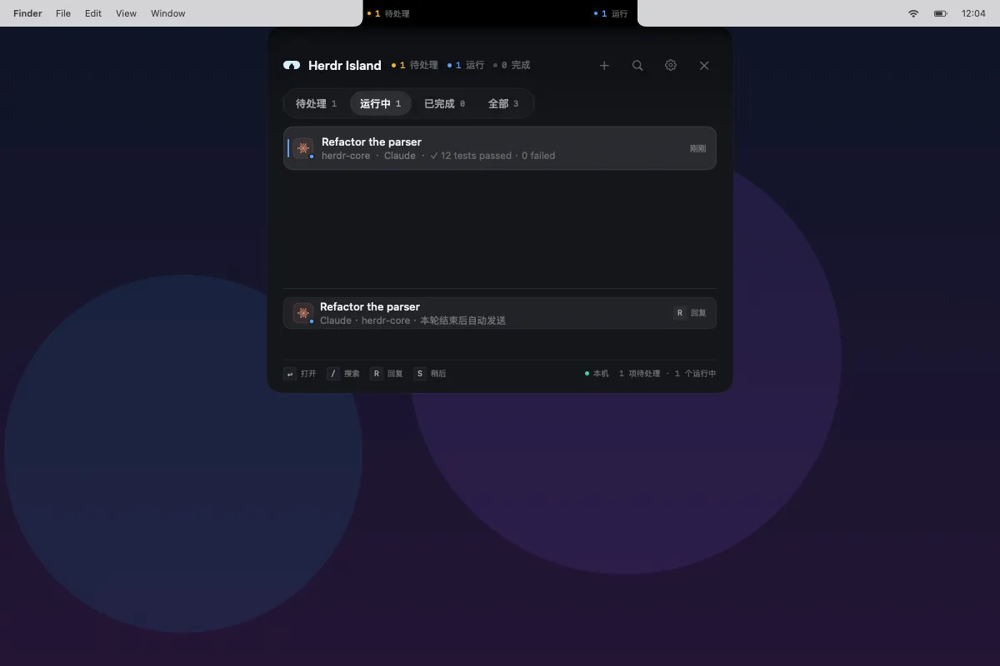

<div align="center">



# Herdr Island

**Your agents, under the notch.**

A native macOS front end for [Herdr](https://github.com/herdrdev/herdr). Herdr runs the agents;
Island puts their status on both sides of the camera notch, with a deck for what needs you,
a real pane terminal, and a composer you can drop anywhere.

**English** · [简体中文](README.zh-CN.md)

[](https://github.com/arronKler/herdr-island/releases)


[](LICENSE)
[](https://arronkler.github.io/herdr-island/)

</div>



<p align="center"><sub>The deck, a running task, and a queued reply. The app interface is currently Simplified Chinese; the website and docs are bilingual.</sub></p>

## Why Herdr Island

Herdr is the runtime: it creates workspaces, starts agents, submits prompts, and owns the
terminal sessions. Island is a second surface for that runtime, designed around the one part
of the screen you already glance at.

- **The notch is the status line.** Collapsed, Island is only as tall as the menu bar. The left
  ear tells you something needs a person; the right ear covers running, done, and idle.
- **Herdr stays in charge.** Island does not replace Herdr, wrap the agents, or talk to model
  vendors directly. It reads Herdr's state and dispatches work back through Herdr.
- **Local by design.** No account, telemetry, analytics, or persistent background service.
  Prompts, screenshots, and attachments stay on this Mac. The only network requests are the
  daily update check and update download from GitHub.
- **A real terminal when you need it.** The detail view attaches to the agent's actual pane,
  not a log viewer or a copy of the output.

## Surfaces

| Surface | Open with | Size | Purpose |
| --- | --- | --- | --- |
| Status ears | always visible | 200 × 28 collapsed | Needs attention on the left, running / done / idle on the right |
| Completion peek | when a task finishes | 400 × 248 | One completed result before the full deck |
| Deck | `⌃⌥H` | 560 × 440–640 | All agents, filters, search, queueing, and actions |
| Detail terminal | `Return` on a row | 660 × 640 | The selected agent's real pane |
| Quick task | `⌃⌥N` | 420 × 196 | A small new-task form in the current directory |
| Drop composer | drag the droplet | 720 × 640 canvas | Shared composer anchored where you release |
| Window composer | `⌥`-drag the droplet | 380 × 510 | A composer locked to one window, with capture |

### The deck

The deck sorts by what needs you first and shows the agent icon, status dot, title, project,
agent kind, elapsed time, the latest terminal line, progress, queued state, and worktree marker.
Blocked rows also show why they are waiting and for how long.

Four filters cover **Needs attention**, **Running**, **Done**, and **All**. Press `/` to search;
labels and project names are searchable. A running agent accepts one queued message, delivered
when the current turn ends unless that pane's interactive terminal is open. A queued message can
be cancelled; a failed send keeps the draft and pauses for a manual retry instead of repeating
blindly.

### The detail terminal

The detail view connects directly to the agent's existing Herdr pane over the single-pane socket
protocol and renders the live ANSI stream with [SwiftTerm](https://github.com/migueldeicaza/SwiftTerm/tree/v1.20.0).
The terminal size is synced to that pane.

- Keyboard input, IMEs including Chinese, multi-line paste, `⌘C` / `⌘V`.
- Files and images can be pasted or dragged in. Images become local PNG paths the agent can read;
  no Enter is appended, and the files remain after the detail closes.
- Mouse reporting goes to the program when it asks for it; hold Shift to drag-select text.
- The wheel reads Herdr's scrollback. Page Up / Page Down go to the terminal program.
- `⌘W` returns to the deck. `Esc`, arrow keys, Tab, and `Ctrl+C` go to the terminal while it has focus.
- Closing the detail only releases the connection; it does not stop the agent. Input is not
  replayed after a disconnect, so check the pane before reconnecting.

Not implemented yet: the full key-down/repeat/key-up protocol, focus reporting, OSC 52 clipboard,
and in-terminal image display. Protocol 22's mouse channel has no acknowledgement, so strict
cross-channel ordering of mouse and keyboard is not guaranteed.

### Send a task anywhere

Drag the droplet below the notch. A liquid neck follows the pointer; past 96pt it detaches into a
small bead. Releasing opens the shared delivery composer anchored above the drop point:

- **Recipient.** Defaults to the persisted main agent. Switch agents from the chip, or start a
  new one. Identity is checked against pane, workspace, and agent kind together.
- **Task.** Multi-line prompt, model, directory, and an optional isolated worktree.
- **Attachments.** Up to 8 files, sent as absolute paths. `~/` is expanded; files are not copied.
- **Delivery.** A busy agent queues one message. A blocked agent is refused. A missing main agent
  starts a new one instead of sending to a guessed target.

Hold `⌥` while dragging to lock the window under the pointer instead. Window and drop surfaces
share the same composer, so the recipient, attachments, queueing, and refusal rules are identical.

### Tasks that need a window

The window composer automatically adds context from the locked window when you send:

| Context | Limit | Source |
| --- | --- | --- |
| Selected text | 4,000 characters | Accessibility |
| Page URL | 2,048 characters | Accessibility |
| Document path | 1,024 characters | Accessibility |
| Window screenshot | one PNG, at send time | ScreenCaptureKit |

Context is best-effort. If a permission is missing or the target app exposes nothing, the field
is empty and delivery still proceeds. Screenshots are saved under
`~/Library/Application Support/HerdrIsland/Captures/` (newest 50) and referenced by absolute path;
capture never runs while the window is only locked.

Window lock is limited to the current Space and current display. Closing and reopening a window
changes its `windowID`, and protected or DRM windows may capture as black. The lock lasts for the
current run only.

### Supported agents

Island shows every agent Herdr recognizes. New tasks can start any of these 12 kinds:

`Claude` · `Codex` · `Cursor` · `Pi` · `Gemini` · `Copilot` · `OpenCode` · `Cline` · `Amp` · `Grok` · `Qwen` · `Kimi`

First-task handling differs by agent. A single-line Claude or Cursor task can be passed natively
as a launch argument. Codex and multi-line tasks wait for a real empty input box before submitting.
Cursor's workspace-trust dialog and Codex's usage/model picker are always yours to handle.

## Requirements

| Requirement | Notes |
| --- | --- |
| macOS 14 or later | Universal release. The app ships arm64 and x86_64 slices, and CI tests and smoke-renders it on an Intel runner. |
| Herdr 0.9.5 | Default CLI: `~/.local/bin/herdr`. Default socket: `~/.config/herdr/herdr.sock`. Override with `HERDR_SOCKET_PATH` or `HERDR_SOCKET`. |
| Ghostty | Optional. Exact jumps into Ghostty use Automation; without it, Island still focuses the Herdr pane. |
| Screen Recording | Optional. Used only for the window screenshot at send time. |
| Accessibility | Optional. Used only to read selected text, URL, and document path from the locked window. |

The detail terminal currently speaks Herdr's single-pane binary protocol 22. Other protocol
versions show an explicit incompatibility message; the deck, delivery, and jumps still work.

On a Mac without a notch, Island appears as a menu-bar item. `⌃⌥H`, `⌃⌥N`, the deck, the detail
terminal, and delivery still work; the droplet and window lock are unavailable.

## Install

Prebuilt releases are on [GitHub Releases](https://github.com/arronKler/herdr-island/releases).

1. Download `HerdrIsland-<version>.zip`, unzip it, and move `HerdrIsland.app` into
   `/Applications`.

   The release also publishes a `.sha256` file. Checking it is optional and only detects a
   corrupted download. Updates are verified automatically by their EdDSA signature, so you never
   need to check an update by hand. To check the first download:

   ```bash
   shasum -a 256 -c HerdrIsland-<version>.zip.sha256
   ```

2. The first launch is blocked by Gatekeeper: the app is ad-hoc signed and not notarized, so macOS
   does not show an identified developer. Go to **System Settings → Privacy & Security**, click
   **Open Anyway**, and authenticate. Or remove the quarantine flag from the downloaded copy before
   moving it:

   ```bash
   xattr -dr com.apple.quarantine ~/Downloads/HerdrIsland.app
   ```

   This fails on `/Applications/HerdrIsland.app`: macOS 14 and later protect installed apps with
   App Management, which reports “Operation not permitted”.

   A manually downloaded build may need this again. Automatic updates do not. Do not disable
   Gatekeeper globally with `sudo spctl --master-disable`.

3. Grant Screen Recording, Automation, and Accessibility when asked. None of them block basic
   use, and each degrades independently.

Apps built from source carry no quarantine flag and skip the Gatekeeper step.

### Updates

Island checks the signed appcast once a day, downloads a new version in the background, and
installs it when you quit or choose to restart. **Check for Updates…** in the menu bar triggers a
check at any time.

The appcast and archive are EdDSA-signed. The public key ships in `Resources/Info.plist`; the
private key lives in the `SPARKLE_ED_PRIVATE_KEY` GitHub Actions secret. Back that key up. With
an ad-hoc signature it is the only update trust path, and losing it strands existing installs.

The updater talks only to GitHub over HTTPS. It sends no account, identifier, prompt, or usage
data. Because the app is ad-hoc signed, macOS may ask again for Screen Recording or Automation
after an update.

## Usage

| Shortcut | Action |
| --- | --- |
| `⌃⌥H` | Open or collapse Island |
| `⌃⌥N` | Open the quick-task panel |
| Drag the droplet | Create a task at the drop point |
| `⌥` + drag the droplet | Lock the window under the pointer |
| `/` | Open the deck and search |
| `R` | Focus the reply field; does nothing on a blocked row |
| `S` | Snooze the selected agent |
| `↑` `↓` | Move the selection |
| `Return` | Open the selected agent's detail |
| `⌘Return` | Send or queue a message, or submit a composer |
| `Esc` | Unwind one layer: composer, search, detail, then the panel. While the terminal has focus, Esc goes to the program. |
| `⌘W` | Return from the detail terminal to the deck |

The main agent is the default recipient for the drop and window composers. The first composer
adopts the selected agent or the first agent that can receive a message; choosing another
recipient updates the persisted main agent. A busy main agent queues one message, a blocked one
refuses, and a missing or reused pane shows "The main agent exited; this delivery will start a
new one."

## Permissions and privacy

Island never auto-approves a blocked agent. It does not send `y`, Enter, or any confirmation key.
Automatic delivery goes through `herdr agent prompt`, which refuses blocked agents. Read, choose,
and answer in the detail terminal or in Herdr.

| Permission | Used for | Without it |
| --- | --- | --- |
| Screen Recording | One window PNG when sending from a locked window | No screenshot; text, context, and files still send |
| Accessibility | Selected text, page URL, and document path from the locked window | Those fields are empty; sending still works |
| Automation | Bringing the Herdr pane forward in Ghostty | The exact jump is unavailable; the pane is still focused |

There is no account, telemetry, or analytics. Prompts, screenshots, and attachments stay on this
Mac. Island's only network requests are the daily appcast check and update download from GitHub.
Data on disk is limited to:

- **Screenshots:** `~/Library/Application Support/HerdrIsland/Captures/`, newest 50.
- **Pasted images:** `~/Library/Caches/HerdrIsland/TerminalImages/`, directory `0700`, files
  `0600`, at most 16 MB / 40 megapixels each, removed after 7 days on the next terminal open or paste.
- **Preferences and main-agent identity:** UserDefaults under `local.herdr.island`.

Attachments are absolute paths, not copies. The complete read/write inventory is in
[What it reads](https://arronkler.github.io/herdr-island/what-it-reads.html); removal steps are in
[Uninstall](https://arronkler.github.io/herdr-island/uninstall.html).

## Architecture

```text
Sources/IslandCore   Pure state machine: domain, reducer, presenter, geometry, key routing. No AppKit.
Sources/HerdrKit     Herdr adapter: CLI, Unix socket, DTOs, Ghostty focus.
Sources/IslandApp    AppKit + SwiftUI shell: panels, menu bar, hotkeys, render harness, settings.
Tests/               Core behavior tests and Herdr adapter tests.
```

`IslandCore` has no Herdr dependency. Every Herdr fact is parsed into an `Agent` at the boundary;
state transitions live in `IslandReducer`; views only render the `IslandPresentation` produced by
`IslandPresenter`.

At runtime:

- **Reads.** `agent.list` and `pane.list` over the Unix socket, sampled every 1.5 seconds with
  state events applied immediately. If the socket is unavailable, Island falls back to the CLI and
  retries the socket after a 10-second cooldown.
- **Writes.** `workspace create`, `worktree create`, `agent start`, and `agent prompt` through the
  Herdr CLI. Write operations are not retried automatically, to avoid duplicate work.
- **Terminal.** A direct single-pane attachment over Herdr's binary protocol 22, rendered with
  SwiftTerm and resized to the real pane.

The app is an `LSUIElement` agent and does not appear in the Dock.

## Build from source

```bash
swift build
Scripts/make-app.sh
open build/HerdrIsland.app
```

`Scripts/make-app.sh` performs a release build, assembles `build/HerdrIsland.app`, and ad-hoc signs it.

To produce a release archive:

```bash
Scripts/make-release.sh 0.1.0
```

This writes the version into `Info.plist`, re-signs, and creates `HerdrIsland-<version>.zip` plus
its `.sha256` under `build/release/`. Pushing a `v<version>` tag runs
`.github/workflows/release.yml`; versions containing `-` (for example `0.1.0-beta.1`) are published
as prereleases.

The release workflow also generates a signed `appcast.xml` and uploads it as a release asset. The
app reads the stable feed at
`https://github.com/arronKler/herdr-island/releases/latest/download/appcast.xml`, so publishing a
release is enough; the site does not need to change. `latest` excludes prereleases, which means
prereleases are manual downloads.

The site is deployed by `.github/workflows/pages.yml`. Push changes under `site/` and the workflow
checks local links and same-page anchors with `Scripts/check-site.py`, then uploads `site/` to
GitHub Pages. Preview locally with:

```bash
python3 -m http.server --directory site 8000
python3 Scripts/check-site.py site
```

<details>
<summary><strong>Development flags</strong></summary>

| Flag | Effect |
| --- | --- |
| `--render <dir>` | Render every fixture PNG, including ambient, peek, deck filters, detail, drop, window, and in-progress states; writes `manifest.json`. |
| `--print-state` | Run a read-only `herdr agent list` and print the derived state JSON. |
| `--demo` | Show the blocked panel from a fixed fixture; no Herdr required. |
| `--no-auto-expand` | Disable automatic expansion for blocked and completed tasks. |
| `--log <path>` | Also write logs to a file. |
| `--new-task <text>` | Open the quick-task panel with text prefilled. |
| `--new-task-send` | With `--new-task`, submit automatically. Creates a real agent. |
| `--open-pane <pane-id>` | Open the detail terminal once that agent is discovered. Honors `HERDR_SOCKET_PATH`. |
| `--check-updates` | Trigger an update check on launch; useful for testing Sparkle setup. |

</details>

<details>
<summary><strong>Design assets</strong></summary>

The app icon is the "negative-space island": a notch silhouette on an ice-blue tile, with the
droplet cut out of it. [The SVG source](Sources/IslandApp/Resources/Brand/HerdrIsland.svg) is the
only hand-maintained artwork; the menu bar, deck, settings, and render harness share marks derived
from it. The menu-bar item is always a monochrome template without a tile, so macOS adapts it to
the background; it does not change color with status.

After editing the SVG, run `Scripts/make-icons.sh` to regenerate the native vector PDF, the
transparent mark SVG, and `Resources/HerdrIsland.icns`. The script needs `rsvg-convert`
(`brew install librsvg`), Python 3, and macOS `iconutil`. Generated assets are committed, so a
normal build does not need image tooling.

</details>

## Testing

```bash
swift test
```

Core tests use a fixed clock and fixtures and do not require a running Herdr. Live terminal
coverage and remaining gaps are recorded in
[docs/terminal-verification-2026-11-10.md](docs/terminal-verification-2026-11-10.md).

Optional live benchmarks are skipped by default:

```bash
# Read-only: alternate CLI and socket queries, 30 runs each; print median and p95.
ISLAND_BENCHMARK_READS=1 swift test --filter TaskCreationPerformanceTests/testLiveReadTransport

# Creates a real Claude task and cleans up the test workspace after it starts.
ISLAND_BENCHMARK_CREATE=1 swift test --filter TaskCreationPerformanceTests/testLiveTaskCreation
```

The [baseline](docs/performance-baseline-2026-11-06.md) and
[optimization report](docs/performance-optimization-2026-11-06.md) contain raw samples, success
and failure counts, source and artifact hashes, and rerun commands.

## Known limitations

These are current boundaries, not a roadmap. The maintained list, with conditions and workarounds,
is in [Known issues](https://arronkler.github.io/herdr-island/known-issues.html).

- The app UI is Simplified Chinese only; there is no in-app English localization yet.
- The detail terminal supports Herdr 0.9.5's protocol 22 only. Other versions show an explicit
  incompatibility error, while the deck and delivery continue to work.
- Prebuilt releases are universal, covering Apple Silicon and Intel, and ad-hoc signed, not
  notarized. Gatekeeper needs a manual approval, and permissions may be requested again after an
  update.
- The update feed uses `releases/latest`, so prereleases are not offered automatically.
- Window lock only covers the current Space and display. Minimizing, switching Spaces, or
  reopening a window breaks capture; DRM-protected windows may capture as black.
- A busy agent accepts only one queued message. Blocked or unknown-state agents cannot receive
  automatic messages.
- Attachments are absolute paths, at most 8, and are not copied. Missing files are dropped before
  sending; pasted images are limited to 16 MB / 40 megapixels and expire after 7 days.
- Screenshot capture has no separate cancel button. Closing the composer does not abort a capture
  that is already running.
- A failed new task can leave its workspace behind. Island preserves the draft and stage, refuses
  to retry automatically when the outcome is uncertain, and leaves the pane for inspection.
- The drop surface covers the desktop while open, so a click outside the composer hits the modal
  layer instead of the app below. This is a deliberate quick-capture tradeoff.

## Documentation

| Document | Contents |
| --- | --- |
| [FAQ](https://arronkler.github.io/herdr-island/faq.html) | Installation, daily use, permissions, troubleshooting |
| [Known issues](https://arronkler.github.io/herdr-island/known-issues.html) | Current limits, conditions, and workarounds |
| [What it reads](https://arronkler.github.io/herdr-island/what-it-reads.html) | Every Herdr call, macOS read, local write, and permission |
| [Uninstall](https://arronkler.github.io/herdr-island/uninstall.html) | Remove the app, data, preferences, and permissions |
| [Terminal verification](docs/terminal-verification-2026-11-10.md) | Live terminal behavior and uncovered protocol features |
| [Performance baseline](docs/performance-baseline-2026-11-06.md) | Original measurements and environment |
| [Performance optimization](docs/performance-optimization-2026-11-06.md) | Parallel optimization results and remaining gaps |

The website is available in [English](https://arronkler.github.io/herdr-island/) and
[Chinese](https://arronkler.github.io/herdr-island/zh/). It follows the system language and
remembers a manual switch.

## Contributing

Issues and pull requests are welcome.

- For a bug report, include the Island version from **Settings → Environment**, macOS version,
  Mac model and notch status, Herdr version, any protocol message, reproduction steps, and
  relevant logs from `--log <path>`.
- Do not paste tokens, private source code, or full window screenshots into an issue. Redact
  anything sensitive and keep only a minimal reproduction.
- Before sending a pull request, run `swift test`. Keep `IslandCore` free of AppKit and Herdr
  dependencies, keep Herdr facts at the `HerdrKit` boundary, and do not add network requests,
  telemetry, or background services beyond the Sparkle update check.

Agent names and logos are trademarks of their respective owners.

## Acknowledgements

- [Herdr](https://github.com/herdrdev/herdr) — the runtime that creates workspaces, runs agents,
  and owns the terminal sessions.
- [SwiftTerm](https://github.com/migueldeicaza/SwiftTerm) — the terminal renderer used by the
  detail view.
- [Sparkle](https://github.com/sparkle-project/Sparkle) — signed appcast updates.
- The agent vendors whose official marks identify each row in the deck.

## License

Herdr Island is released under the [MIT License](LICENSE).

Copyright © 2026 arronKler.
