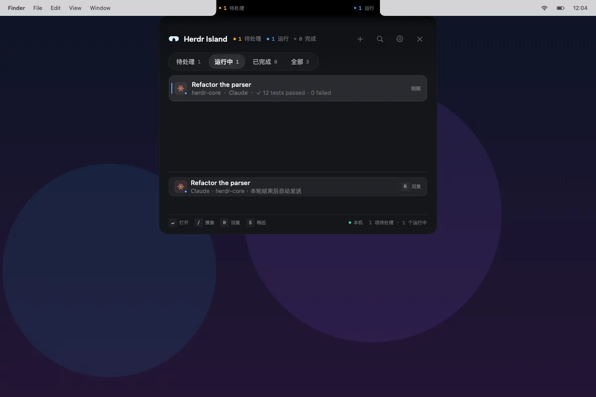

<div align="center">



# Herdr Island

**屏幕凹口下，你的 agent 在值班。**

[Herdr](https://github.com/herdrdev/herdr) 的原生 macOS 图形前端。Herdr 负责运行 agent；
Island 把状态放进屏幕顶部的凹口两侧，提供任务台、真实终端，以及一个可以拖到任意位置的投递框。

[English](README.md) · **简体中文**

[](https://github.com/arronKler/herdr-island/releases)


[](LICENSE)
[](https://arronkler.github.io/herdr-island/zh/)

</div>



<p align="center"><sub>任务台、运行中的任务和一条排队回复。应用界面为简体中文；官网与文档提供中英文两版。</sub></p>

## 为什么是 Herdr Island

Herdr 是执行层：创建 workspace、启动 agent、提交任务、维护终端会话。Island 是它之上的另一个界面，围绕你本来就会瞥一眼的那块屏幕区域设计。

- **屏幕顶端就是状态栏。** 收起时 Island 只占菜单栏高度。左耳告诉你有人需要你处理；右耳显示运行、完成或空闲。
- **Herdr 仍然是执行者。** Island 不替代 Herdr，不包裹 agent，也不直接连接模型厂商。它读取 Herdr 的状态，再通过 Herdr 派发任务。
- **本地优先。** 没有账号、遥测、分析或常驻后台服务。任务、截图和附件都留在这台 Mac 上。唯一的网络请求是每天检查更新并从 GitHub 下载新版本。
- **需要时，终端是真的。** 详情视图连接 agent 的实际 pane，不是日志查看器，也不是输出的副本。

## 界面

| 界面 | 打开方式 | 尺寸 | 作用 |
| --- | --- | --- | --- |
| 状态双耳 | 常驻 | 收起 200 × 28 | 左侧待处理，右侧运行 / 完成 / 空闲 |
| 完成轻提示 | 任务完成时 | 400 × 248 | 进入完整任务台之前先显示一条完成结果 |
| 任务台 | `⌃⌥H` | 560 × 440–640 | 全部 agent、筛选、搜索、排队和操作 |
| 详情终端 | 选中一行后按 `Return` | 660 × 640 | 所选 agent 的真实 pane |
| 快速任务 | `⌃⌥N` | 420 × 196 | 沿用当前目录的小型新任务框 |
| 水滴投递框 | 拖动水滴 | 720 × 640 画布 | 松手位置出现的共享投递框 |
| 窗口投递框 | `⌥` + 拖动水滴 | 380 × 510 | 锁定一个窗口并附带截图的投递框 |

### 任务台

任务台把需要你处理的内容排在前面，每行显示 agent 图标、状态点、标题、项目、agent 类型、耗时、最近一行终端输出、进度、排队状态和 worktree 标记。blocked 行还会显示原因和等待时长。

四个筛选分别是 **待处理**、**运行中**、**已完成** 和 **全部**。按 `/` 搜索，标签和项目名也可搜索。运行中的 agent 可以排队一条消息，在本轮结束且该 pane 的交互终端未打开时自动投递。排队项可以取消；发送失败时保留草稿并暂停，等待手动重试，而不是盲目重发。

### 详情终端

详情视图通过 Herdr 的单 pane socket 协议直接连接 agent 已有的 pane，并用 [SwiftTerm](https://github.com/migueldeicaza/SwiftTerm/tree/v1.20.0) 渲染实时 ANSI 流。终端尺寸会同步给该 pane。

- 键盘输入、中文等输入法、多行粘贴、`⌘C` / `⌘V`。
- 可以粘贴或拖入文件和图片。图片会变成 agent 可读取的本地 PNG 路径；不追加 Enter，关闭详情后文件仍然保留。
- 程序启用鼠标报告时，鼠标事件交给程序；按住 Shift 拖动可选择文字。
- 滚轮读取 Herdr 的历史输出，Page Up / Page Down 交给终端程序。
- `⌘W` 返回任务台。终端聚焦时，`Esc`、方向键、Tab 和 `Ctrl+C` 交给终端程序。
- 关闭详情只释放连接，不停止 agent。断线后不会自动重放输入，重连前请先检查 pane。

尚未实现：完整的 key-down / repeat / key-up 协议、焦点报告、OSC 52 剪贴板和终端内图片显示。协议 22 的鼠标通道没有确认，因此鼠标与键盘跨通道的严格顺序不保证。

### 随处投递

把水滴拖到岛下方。液态颈部跟随指针，超过 96pt 后完全脱离成一颗小水珠。松手后，共享投递框出现在落点上方：

- **收件人。** 默认是持久化的主 agent。可以通过收件人按钮切换，或新建 agent。身份按 pane、workspace 和 agent kind 三者一起校验。
- **任务。** 多行任务、模型、目录，以及可选的隔离 worktree。
- **附件。** 最多 8 个文件，以绝对路径发送。`~/` 会展开；文件不会被复制。
- **投递。** 忙碌的 agent 只排队一条消息；blocked 的 agent 拒绝发送；主 agent 不存在时会新建一个，而不是发给猜测的目标。

按住 `⌥` 拖动水滴，则改为锁定指针下的窗口。窗口投递框和水滴投递框共用同一个组件，所以收件人、附件、排队和拒绝规则完全一致。

### 需要看窗口的任务

窗口投递框在发送时会自动补充锁定窗口的上下文：

| 上下文 | 上限 | 来源 |
| --- | --- | --- |
| 选中文本 | 4,000 字符 | 辅助功能 |
| 网页地址 | 2,048 字符 | 辅助功能 |
| 文档路径 | 1,024 字符 | 辅助功能 |
| 窗口截图 | 发送时截取一张 PNG | ScreenCaptureKit |

上下文是 best-effort。权限缺失或目标应用没有暴露相应属性时，字段为空，投递仍然继续。截图保存在 `~/Library/Application Support/HerdrIsland/Captures/`（保留最新 50 张），prompt 中只带绝对路径；锁定期间不会持续截屏。

窗口锁定只支持当前 Space、当前屏幕上的窗口。窗口关闭再打开会改变 `windowID`；受 DRM 或安全保护的窗口可能只能截到黑屏。锁定只存在于本次运行期间。

### 支持的 agent

Herdr 能识别的 agent 都会出现在 Island 里。新任务可以启动以下 12 种：

`Claude` · `Codex` · `Cursor` · `Pi` · `Gemini` · `Copilot` · `OpenCode` · `Cline` · `Amp` · `Grok` · `Qwen` · `Kimi`

不同 agent 的首条任务处理方式不同。Claude、Cursor 的单行任务可以通过启动参数原生传入；Codex 和多行任务会先等待真实的空输入框。Cursor 的工作区信任弹窗和 Codex 的用量 / 模型选择弹窗始终需要你亲自处理。

## 环境要求

| 要求 | 说明 |
| --- | --- |
| macOS 14 或更新版本 | 通用二进制。发布包含 arm64 与 x86_64 切片，CI 会在 Intel runner 上运行测试和渲染冒烟。 |
| Herdr 0.9.5 | 默认 CLI：`~/.local/bin/herdr`。默认 socket：`~/.config/herdr/herdr.sock`。可用 `HERDR_SOCKET_PATH` 或 `HERDR_SOCKET` 覆盖。 |
| Ghostty | 可选。精确跳转 Ghostty 需要 Automation 权限；没有 Ghostty 时仍会聚焦 Herdr pane。 |
| Screen Recording | 可选。只在发送窗口任务时截取一张图。 |
| 辅助功能 | 可选。只用于读取锁定窗口的选中文本、网页地址和文档路径。 |

详情终端目前只适配 Herdr 0.9.5 的单 pane 二进制协议 22。其他协议版本会显示明确的不兼容提示；任务台、投递和跳转仍然可用。

没有屏幕凹口的 Mac 上，Island 作为菜单栏项目运行。`⌃⌥H`、`⌃⌥N`、任务台、详情终端和投递仍然可用；水滴和窗口锁定不可用。

## 安装

预编译版本发布在 [GitHub Releases](https://github.com/arronKler/herdr-island/releases)。

1. 下载 `HerdrIsland-<版本>.zip`，解压后把 `HerdrIsland.app` 放进 `/Applications`。

   Release 里还有一个 `.sha256` 文件。校验它是可选的，只用于发现下载损坏。自动更新由 EdDSA 签名验证，不需要手动校验。想校验第一次下载可以运行：

   ```bash
   shasum -a 256 -c HerdrIsland-<版本>.zip.sha256
   ```

2. 首次打开会被 Gatekeeper 拦截：应用只有 ad-hoc 签名，没有经过 Apple 公证，所以系统不会显示“已识别的开发者”。到 **系统设置 → 隐私与安全性**，点 **仍要打开** 并输入管理员密码。也可以在移动应用之前去掉隔离标记：

   ```bash
   xattr -dr com.apple.quarantine ~/Downloads/HerdrIsland.app
   ```

   不要对 `/Applications/HerdrIsland.app` 执行这条命令：macOS 14 及更新版本会用应用管理保护已安装的应用，会报 “Operation not permitted”。

   手动下载的新版本可能还需要再放行一次，自动更新不会。不要用 `sudo spctl --master-disable` 全局关闭 Gatekeeper。

3. 按提示授予 Screen Recording、Automation 和辅助功能权限。三者都不阻断基本使用，并且会独立降级。

从源码构建的 app 没有 quarantine 标记，不需要上面的放行步骤。

### 更新

Island 每天检查一次签名 appcast，发现新版本后在后台下载，并在退出或选择重启时安装。菜单栏的 **检查更新…** 可以随时手动触发。

appcast 和更新包都使用 EdDSA 签名。公钥在 `Resources/Info.plist`，私钥放在 GitHub Actions 的 `SPARKLE_ED_PRIVATE_KEY` secret。请备份私钥。ad-hoc 签名下它是唯一的更新信任链，丢失后现有安装无法再自动更新。

更新器只通过 HTTPS 访问 GitHub，不上传账号、标识、任务或使用数据。由于应用是 ad-hoc 签名，更新后 macOS 可能再次询问 Screen Recording 或 Automation 权限。

## 快捷键

| 快捷键 | 作用 |
| --- | --- |
| `⌃⌥H` | 打开或收起 Island |
| `⌃⌥N` | 打开快速任务框 |
| 拖动水滴 | 在落点创建任务 |
| `⌥` + 拖动水滴 | 锁定指针下的窗口 |
| `/` | 打开任务台并搜索 |
| `R` | 聚焦回复输入框；blocked 行不生效 |
| `S` | 稍后处理选中的 agent |
| `↑` `↓` | 移动选择 |
| `Return` | 打开选中 agent 的详情 |
| `⌘Return` | 发送或排队消息，或提交投递框 |
| `Esc` | 逐层退出：投递框、搜索、详情、面板。终端聚焦时交给终端程序。 |
| `⌘W` | 从详情终端返回任务台 |

主 agent 是水滴投递框和窗口投递框的默认收件人。第一次打开投递框时，它会采用当前选中的 agent，或第一个可以接收消息的 agent；之后切换收件人会更新持久化的主 agent。主 agent 忙时排队一条，blocked 时拒绝；pane 消失或被复用时提示“主 Agent 已退出，这次将新建”。

## 权限与隐私

Island 不会自动批准 blocked agent。它不会代发 `y`、Enter 或任何确认键。自动投递走 `herdr agent prompt`，而 Herdr 本身会拒绝 blocked agent。请在详情终端或 Herdr 里阅读、选择并回答。

| 权限 | 用途 | 不授权时 |
| --- | --- | --- |
| Screen Recording | 从锁定窗口发送时截取一张窗口 PNG | 不附截图；文本、上下文和文件仍会发送 |
| 辅助功能 | 读取锁定窗口的选中文本、网页地址和文档路径 | 这些字段为空；仍可发送 |
| Automation | 在 Ghostty 中把 Herdr pane 带到前台 | 无法精确跳转；仍会聚焦 pane |

没有账号、遥测或分析。任务、截图和附件都留在这台 Mac 上。唯一的网络请求是每天检查 appcast 和从 GitHub 下载更新。磁盘上的数据只有：

- **截图：** `~/Library/Application Support/HerdrIsland/Captures/`，保留最新 50 张。
- **粘贴图片：** `~/Library/Caches/HerdrIsland/TerminalImages/`，目录 `0700`、文件 `0600`，单张最多 16 MB / 4000 万像素，超过 7 天后在下次打开终端或粘贴时清理。
- **偏好设置和主 agent 身份：** UserDefaults 中的 `local.herdr.island`。

附件是绝对路径，不是副本。完整的读、写和本地保存清单见 [它读了什么](https://arronkler.github.io/herdr-island/zh/what-it-reads.html)；彻底移除的方法见 [卸载](https://arronkler.github.io/herdr-island/zh/uninstall.html)。

## 架构

```text
Sources/IslandCore   纯状态机：domain、reducer、presenter、几何、键盘路由。不依赖 AppKit。
Sources/HerdrKit     Herdr 适配层：CLI、Unix socket、DTO、Ghostty 聚焦。
Sources/IslandApp    AppKit + SwiftUI 外壳：面板、菜单栏、快捷键、渲染和设置。
Tests/               核心行为测试和 Herdr 适配测试。
```

`IslandCore` 不依赖 Herdr。所有 Herdr 事实在边界解析成 `Agent`，状态变化由 `IslandReducer` 一处决定，视图只渲染 `IslandPresenter` 给出的 `IslandPresentation`。

运行时：

- **读取。** 通过 Unix socket 调用 `agent.list` 和 `pane.list`，每 1.5 秒采样，状态事件即时应用。socket 不可用时回退 CLI，并在 10 秒冷却后重试 socket。
- **写入。** 通过 Herdr CLI 执行 `workspace create`、`worktree create`、`agent start` 和 `agent prompt`。写操作不会自动重试，避免重复执行。
- **终端。** 通过 Herdr 的二进制协议 22 直接附着单 pane，用 SwiftTerm 渲染，并把尺寸同步给真实 pane。

应用是 `LSUIElement`，不会出现在 Dock。

## 从源码构建

```bash
swift build
Scripts/make-app.sh
open build/HerdrIsland.app
```

`Scripts/make-app.sh` 执行 release 构建，组装 `build/HerdrIsland.app`，然后做 ad-hoc 签名。

生成发布包：

```bash
Scripts/make-release.sh 0.1.0
```

脚本把版本写入 `Info.plist`，重新签名，并在 `build/release/` 生成 `HerdrIsland-<版本>.zip` 和同名 `.sha256`。推送 `v<版本>` 标签会触发 `.github/workflows/release.yml`；带 `-` 的版本（例如 `0.1.0-beta.1`）会发布为 prerelease。

release 工作流还会生成签名 `appcast.xml` 并作为 Release 资产上传。应用读取稳定地址 `https://github.com/arronKler/herdr-island/releases/latest/download/appcast.xml`，所以发布 Release 就够了，不需要改站点。`latest` 不包含 prerelease，因此 prerelease 版本需要手动下载。

站点由 `.github/workflows/pages.yml` 发布。推送 `site/` 下的改动后，工作流先用 `Scripts/check-site.py` 检查本地链接与页内锚点，再把 `site/` 上传到 GitHub Pages。本地预览：

```bash
python3 -m http.server --directory site 8000
python3 Scripts/check-site.py site
```

<details>
<summary><strong>开发参数</strong></summary>

| 参数 | 作用 |
| --- | --- |
| `--render <dir>` | 渲染全部 fixture PNG，包括 ambient、peek、任务台筛选、详情、水滴、窗口和创建中的状态；写入 `manifest.json`。 |
| `--print-state` | 只读执行 `herdr agent list`，打印推导后的状态 JSON。 |
| `--demo` | 使用固定 fixture 展示 blocked 面板，不依赖 Herdr。 |
| `--no-auto-expand` | 关闭 blocked 和完成状态的自动展开。 |
| `--log <path>` | 同时把日志写入指定文件。 |
| `--new-task <text>` | 打开快速任务框并预填文本。 |
| `--new-task-send` | 与 `--new-task` 一起用，预填后自动提交。会创建真实 agent。 |
| `--open-pane <pane-id>` | 首次发现该 agent 后打开详情终端。遵循 `HERDR_SOCKET_PATH`。 |
| `--check-updates` | 启动后立即检查一次更新，测试 Sparkle 配置用。 |

</details>

<details>
<summary><strong>设计资源</strong></summary>

应用图标采用“负形之岛”：冰蓝色底板上的凹口轮廓，用水滴负形留出开口。[SVG 源文件](Sources/IslandApp/Resources/Brand/HerdrIsland.svg) 是唯一手工维护的图稿；菜单栏、任务台、设置页和渲染页共用从它派生的标记。菜单栏始终使用无底板、透明镂空的单色模板，由 macOS 按背景自动显示为白色或深色，不随任务状态变色。

修改 SVG 后运行 `Scripts/make-icons.sh`，生成原生矢量 PDF、透明标记 SVG 和 `Resources/HerdrIsland.icns`。脚本需要 `rsvg-convert`（`brew install librsvg`）、Python 3 和 macOS 自带的 `iconutil`。生成物已随源码保存，正常构建无需安装图像工具。

</details>

## 测试

```bash
swift test
```

核心测试使用固定时钟和 fixture，不需要运行 Herdr。单任务实时终端的验证范围与尚未覆盖的能力见 [终端验证记录](docs/terminal-verification-2026-11-10.md)。

实时性能基准默认跳过：

```bash
# 只读：交替执行 CLI / socket 查询，各 30 次，输出中位数和 p95。
ISLAND_BENCHMARK_READS=1 swift test --filter TaskCreationPerformanceTests/testLiveReadTransport

# 会创建一个真实 Claude 任务，确认开始后清理该测试 workspace。
ISLAND_BENCHMARK_CREATE=1 swift test --filter TaskCreationPerformanceTests/testLiveTaskCreation
```

[初始基线](docs/performance-baseline-2026-11-06.md) 和 [并行优化报告](docs/performance-optimization-2026-11-06.md) 包含原始样本、成功与失败数、源码 / 产物哈希及复跑命令。

## 已知限制

以下是当前版本的真实边界，不是路线图。带条件和规避方式的维护清单见 [已知问题](https://arronkler.github.io/herdr-island/zh/known-issues.html)。

- 应用界面目前只有简体中文，还没有 in-app 英文本地化。
- 详情终端只支持 Herdr 0.9.5 的协议 22。其他版本会显示明确的不兼容错误，任务台和投递仍然可用。
- 预编译版本为通用二进制，支持 Apple Silicon 与 Intel，且为 ad-hoc 签名、未公证。首次启动需要手动放行，更新后权限可能再次询问。
- feed 使用 `releases/latest`，prerelease 不会被自动推送。
- 窗口锁定只覆盖当前 Space 和当前屏幕。最小化、切换 Space 或重新打开窗口都会导致截图失败；受 DRM 保护的窗口可能只能截到黑屏。
- 忙碌的 agent 只接受一条排队消息。blocked 或状态未知的 agent 不能接收自动消息。
- 附件是绝对路径，最多 8 个，不会复制。缺失文件会在发送前被移除；粘贴图片限制为 16 MB / 4000 万像素，7 天后过期。
- 截图没有单独的取消按钮。关闭投递框不会中止已经开始的截图调用。
- 新任务失败时可能留下 workspace。Island 会保留草稿和阶段，在结果不确定时拒绝自动重试，把 pane 留给你检查。
- 水滴投递框打开时会覆盖桌面，投递框之外的点击会先落到模态层，而不是下方应用。这是为了快速捕捉任务而做的取舍。

## 文档

| 文档 | 内容 |
| --- | --- |
| [FAQ](https://arronkler.github.io/herdr-island/zh/faq.html) | 安装、日常使用、权限、故障排查 |
| [已知问题](https://arronkler.github.io/herdr-island/zh/known-issues.html) | 当前限制、触发条件和规避方式 |
| [它读了什么](https://arronkler.github.io/herdr-island/zh/what-it-reads.html) | 每一次 Herdr 调用、macOS 读取、本地写入和权限 |
| [卸载](https://arronkler.github.io/herdr-island/zh/uninstall.html) | 移除应用、数据、偏好设置和权限 |
| [终端验证记录](docs/terminal-verification-2026-11-10.md) | 实时终端行为和尚未覆盖的协议能力 |
| [性能基线](docs/performance-baseline-2026-11-06.md) | 原始测量数据和环境 |
| [性能优化](docs/performance-optimization-2026-11-06.md) | 并行优化结果与剩余差距 |

官网提供 [英文](https://arronkler.github.io/herdr-island/) 和 [中文](https://arronkler.github.io/herdr-island/zh/) 两个版本，会跟随系统语言并记住手动切换。

## 参与贡献

欢迎提 issue 和 pull request。

- 报告 bug 时，请附上 **设置 → 环境** 里的 Island 版本、macOS 版本、Mac 型号和是否有屏幕凹口、Herdr 版本、协议提示、复现步骤，以及用 `--log <路径>` 生成的日志。
- 不要在 issue 里粘贴 token、私有源码或完整窗口截图。脱敏后只保留最小复现所需的内容。
- 提交 pull request 前先运行 `swift test`。保持 `IslandCore` 不依赖 AppKit 和 Herdr，把 Herdr 事实留在 `HerdrKit` 边界，不要添加 Sparkle 更新之外的网络请求、遥测或后台服务。

Agent 名称和图标归各自所有者所有。

## 致谢

- [Herdr](https://github.com/herdrdev/herdr)：创建 workspace、运行 agent、维护终端会话的执行层。
- [SwiftTerm](https://github.com/migueldeicaza/SwiftTerm)：详情视图使用的终端渲染器。
- [Sparkle](https://github.com/sparkle-project/Sparkle)：签名 appcast 自动更新。
- 为任务台每一行提供官方标记的各 agent 厂商。

## 许可

Herdr Island 以 [MIT License](LICENSE) 发布。

Copyright © 2026 arronKler.
